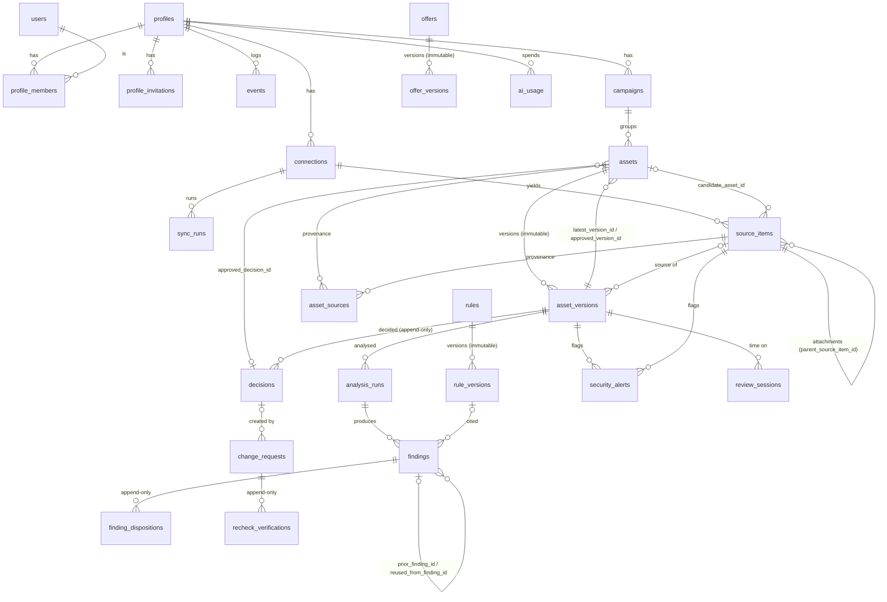

# Database schema

The Postgres schema behind the compliance review workbench, in Supabase project `dquwmmysasjvvgxnbhdl`. The source of truth is `supabase/migrations/`. This file explains the model so that app code can use it correctly. §8 covers deployment.

Migrations, applied in order:

| File | Contents |
|---|---|
| `20261106170000_tenancy_auth.sql` | `pgcrypto`, default-privilege hardening, `private` schema, `users` (mirror of `auth.users`), `profiles`, `profile_members`, `profile_invitations`, `events`, RLS helpers, tenancy RPCs |
| `20261106170100_intake.sql` | `connections`, `sync_runs`, `campaigns`, `assets`, `source_items`, `asset_sources`, `asset_versions` and their triggers (pointer guard, asset audit, version numbering, queued analysis run) |
| `20261106170200_review.sql` | `reference_library`, `rules`/`rule_versions`, `offers`/`offer_versions`, `analysis_runs`, `findings`, `finding_dispositions`, `security_alerts`, `decisions`, `change_requests`, `recheck_verifications`, `review_sessions`, the `finding_latest_dispositions` and `asset_queue` views, and the review RPCs |
| `20261106170300_policies_ai.sql` | `ai_usage` and the budget RPCs, all table grants, immutability triggers, all RLS policies |
| `20261106170400_storage.sql` | `private-assets` bucket and its `storage.objects` policy |

Each file can be re-run safely. They have been applied twice in a row to Postgres 17 (PGlite) with stubbed `auth` and `storage` schemas, and a 249-check behaviour suite passed. That covers tenancy, invitations, RLS, intake privacy, drafts, decisions, change requests, recheck, the AI budget, storage, member removal, user deletion, purge and grants. Every foreign key has a covering index.

---

## 1. Ground rules

- **Tenancy.** A *profile* is a workspace. Every workspace-owned table has `profile_id uuid not null references profiles on delete cascade`, and an index leads with it. There are only two roles: `owner` and `member`.
- **Read model.** Members read every row of their profiles, with three exceptions:
  - `profile_invitations` is readable by owners only, and `token_hash` by no API role.
  - `source_items` from a member's own connected mailbox or drive are private to that member until they look like marketing (see §6.4).
  - A `security_alerts` row on a source item follows that item's visibility.
- **Cross-tenant links are impossible.** Child rows point at parents through composite foreign keys `(parent_id, profile_id) → parent(id, profile_id)`. This holds even for server code that uses the secret key. Pointers that must stay inside one asset use `(version_id, asset_id) → asset_versions(id, asset_id)`.
- **RLS is on for every table.** Every policy targets `authenticated`. `anon` has no table privileges and can execute no `public` function.
- **Writes.** Browser and user-context clients write directly only where §5 allows it. Everything else goes through a `SECURITY DEFINER` RPC, or through the server using the **secret key** (role `service_role`, which bypasses RLS).
- **Functions.** Every function sets `search_path = ''` and fully qualifies names. Helpers live in the `private` schema, which the Data API does not expose. Default privileges are hardened. Functions created later by `postgres` are executable by nobody, `public` included, until they are granted. **Every new RPC needs an explicit `grant execute … to authenticated`.**
- **Hashes** are lowercase hex SHA-256 (`^[0-9a-f]{64}$`), enforced by CHECK constraints.
- **Storage paths** look like `profiles/{profile_id}/...`. A source item's object must be at `profiles/{profile_id}/sources/{source_item_id}/…`. A version's object must be at `profiles/{profile_id}/versions/…` and is unique per version.

### Error codes raised by RPCs and triggers

supabase-js returns the code as `error.code`. The `PTxxx` codes are PostgREST's custom-status codes, so the HTTP status matches the meaning.

| SQLSTATE | Meaning | HTTP (PostgREST) |
|---|---|---|
| `PT404` | Not found, or not a member. Deliberately the same answer, so isolation leaks nothing. | 404 |
| `PT409` | State conflict: draft, not the latest version, unacknowledged alert, Fix required, analysis running or missing, identical content, last owner | 409 |
| `PT422` | Invalid input: bad email, short justification or note, missing rationale or attestation, bad change request | 422 |
| `PT429` | Limit reached (3 profiles created per user) | 429 |
| `42501` | Forbidden: not owner, unverified or wrong email, write to an immutable table, direct approval or pointer change, connector owner not a member | 403 (401 for anon) |
| `23505` | Already a member | 409 |
| `23503` | Referenced row missing or in another profile | 409 |

---

## 2. Tables

### Tenancy and audit

| Table | Key columns | Notes |
|---|---|---|
| `users` | `id` (PK, FK `auth.users`, cascade), `email` (lowercase), `full_name`, `avatar_url` (**https only**), `created_at`, `updated_at` | Kept in sync by triggers on `auth.users` insert and update. Email always follows auth. Name and avatar from OAuth metadata only fill blanks, so edits made in the app win. A non-https avatar is dropped. `full_name` is free text, so the UI always shows the email next to it. |
| `profiles` | `id`, `name` (1–80 chars, trimmed), `created_by`, `settings` jsonb, `created_at`, `updated_at` | Operator-managed settings: `ai_daily_cap_usd` (a number from 0 to 10, default 3) and `ai_trusted` (boolean). Other keys are free-form (`equal_housing_legend`, `states`, …). |
| `profile_members` | PK `(profile_id, user_id)`, `role` (`owner`\|`member`), `invited_by`, `created_at` | A trigger keeps at least one owner per profile. Concurrent removals are serialized by locking the profile row. The one exception is deleting an account whose profile then has no members at all (§3). |
| `profile_invitations` | `id`, `profile_id`, `email` (lowercase), `role`, `invited_by`, `token_hash` (unique sha256 hex), `created_at`, `expires_at` (+7 days), `accepted_at`, `accepted_by`, `revoked_at` | One pending invitation per `(profile_id, email)`. The plaintext token is never stored. Only owners can read rows. Name the columns you select, because `token_hash` is not granted and `select('*')` fails. |
| `events` | `id` bigint identity, `profile_id`, `asset_id`, `actor_id` (no FK, so the log outlives deleted users), `kind`, `data`, `created_at` | **Append-only** audit log. `actor_id` is `auth.uid()`, else a transaction-local `app.actor_id` set by a server RPC wrapper, else null (system). |

### Intake

| Table | Key columns | Notes |
|---|---|---|
| `connections` | `id`, `profile_id`, `provider` (`google-mail`, `google-drive`, `google-sheet`, `outlook`, `one-drive`, `one-drive-personal`), `provider_group` (generated: `google`\|`microsoft`), `nango_connection_id`, `provider_config_key` (must equal `provider`), `account_email`, `connected_by`, `status` (`connected`, `syncing` (default), `needs_reconnect`, `error`, `disconnected`), `watch`, `cursor`, `last_synced_at`, `last_error` | One row per Nango connection. **Unique on `(provider_config_key, nango_connection_id)`**, the pair Nango uses to identify a connection. Only the server writes here. An insert trigger requires `connected_by` to be a **current member** of `profile_id`. |
| `sync_runs` | `id`, `profile_id`, `connection_id`, `kind` (`initial`, `incremental`, `gap_rescan`, `manual`), `started_at`, `finished_at`, `stats`, `error` | Backs the sync log in the Sources drawer. |
| `source_items` | `id`, `profile_id`, `connection_id`, `provider` (the six above plus `upload`, `paste`, `import`), `kind` (`email`, `attachment`, `file`, `sheet_row`, `upload`, `paste`), `external_id`, `parent_external_id` (thread or folder), `parent_source_item_id` (attachment → its email row), **`source_key`**, **`source_revision`**, `source_url`, `title`, `sender`, `sender_email`, `occurred_at`, `mime_type`, `size_bytes`, **`content_sha256`**, **`normalized_text_hash`**, `storage_path`, `extracted_text`, `metadata`, `classification`, `classification_reason`, `inferred`, `candidate_asset_id`, `match_score`, `match_reason`, `triage_status`, `triage_reason`, `snoozed_until`, `triaged_by`, `triaged_at`, `duplicate_of`, `asset_id`, **`visibility`** (generated) | Raw arrivals. Holds untrusted content. The idempotency key is `UNIQUE NULLS NOT DISTINCT (profile_id, source_key, source_revision, content_sha256)`. `classification` is one of `pending`, `marketing`, `not_marketing`, `uncertain`, `duplicate`, `new_version`, `inline_image` (signature logos and CID images). `triage_status` is one of `pending`, `accepted`, `declined`, `merged`, `snoozed`, `split`, `versioned`. `asset_id` is the *primary* asset only; `asset_sources` is the truth for split and merge. Items classified `not_marketing` never keep `extracted_text` (a trigger enforces this). |
| `campaigns` | `id`, `profile_id`, `name`, `defaults` jsonb, `created_by` | Unique on `(profile_id, lower(name))`. |
| `assets` | `id`, `profile_id`, `campaign_id`, `title`, `product` (`personal_loan`, `credit_card`, `mortgage`, `other`, `unknown`), `channel`, `submitter_name`, `submitter_email`, `submitter_org`, `states[]`, `audience`, `due_date`, `status`, **`submitted_at`**, **`is_draft`** (generated), **`latest_version_id`**, **`approved_version_id`**, **`approved_decision_id`**, **`changed_after_approval`** (generated), `re_review_reason`, `assignee_id` (must be a current member), `in_market_from`, `in_market_to`, `approval_expires_at`, `retain_until`, `created_by` | Indexed on `(profile_id, status, updated_at desc)` for the queue, on `(profile_id, assignee_id, status)` for "Needs my decision", and partially on `changed_after_approval`. Removing a member clears their assignments. |
| `asset_sources` | PK `(asset_id, source_item_id)`, `profile_id` | Provenance, so the UI can show "Seen in 2 sources". |
| `asset_versions` | `id`, `profile_id`, `asset_id`, `version_no` (assigned by trigger), `origin` (`upload`, `paste`, `sync`, `email`, `reviewer_edit`, `suggestion_applied`, `import`), `source_item_id`, `author_id`, `content` jsonb, `extracted_text`, `content_sha256` (required), `normalized_text_hash`, `storage_path` | **Immutable.** `author_id` is **required** for `upload`, `paste`, `reviewer_edit` and `suggestion_applied`. A version whose `content_sha256` equals the latest version's is refused (`PT409`, hint `unchanged`). `storage_path` is unique and under `versions/`. |

`assets.status` takes one of these values:

| Status | Meaning |
|---|---|
| `preflighting` | Draft, not yet submitted. Reviewers never see it in the queue. |
| `needs_review` | Submitted and waiting for a reviewer. |
| `needs_manual_review` | Analysis failed or was declined for budget. A reviewer must check it by hand. |
| `changes_requested` | A reviewer asked for changes. |
| `recheck_ready` | A new version arrived after changes were requested. |
| `approved` | Approved with no exceptions. |
| `approved_with_exceptions` | Approved, with written exceptions for Critical/Major findings. |
| `rejected` | Rejected. |
| `re_review_due` | Something the approval relied on changed (for example an offer). |
| `withdrawn` | Withdrawn. |

CHECKs keep `status` consistent with the pointers:

- A draft can only be `preflighting` or `withdrawn`.
- `approved` and `approved_with_exceptions` need `approved_version_id`.
- `withdrawn` needs it to be null.
- `approved_version_id` and `approved_decision_id` are set together or both null.

Analysis progress is not a status. Read it from `analysis_runs.status` and `analysis_runs.stage`, or from `asset_queue`.

### Policies (rules, offers) and review

| Table | Key columns | Notes |
|---|---|---|
| `reference_library` | `id` text (e.g. `reg-z-1026-24`), `label`, `citation`, `url`, `summary`, `verified_as_of` | Global and read-only. The operator seeds it. |
| `rules` | `id`, `profile_id` (**null = starter library**), `code`, `kind` (`regulatory`, `policy`, `offer`, `security`), `active`, `cloned_from`, **`current_version_id`** | Identity only. `UNIQUE NULLS NOT DISTINCT (profile_id, code)`. `profile_id` never changes. `cloned_from` must point at a starter rule or a rule in the same profile. `current_version_id` is maintained by the `rule_versions` insert trigger. Archive a rule with `active = false`. |
| `rule_versions` | `id`, `rule_id`, `profile_id` (copied by trigger), `version_no` (trigger), **`title`**, **`applies_to[]`**, **`default_severity`**, `body`, `reference_ids[]`, `metadata`, `reason` (required), `author_id` | **Immutable.** Scope and severity are versioned, so a run's `rule_version_ids` show exactly what was in force. |
| `offers` | `id`, `profile_id`, `code` (e.g. `PL-1`), `product`, `name`, `active` | |
| `offer_versions` | `id`, `offer_id`, `profile_id`, `version_no` (trigger), `terms` jsonb, `effective_from`, `effective_to`, `reason` (required), `author_id` | **Immutable.** |
| `analysis_runs` | `id`, `profile_id`, `asset_version_id`, `status` (`queued`, `running`, `complete`, `failed`, `declined_budget`), `stage`, `model`, `prompt_hash`, `rule_version_ids[]`, `offer_version_ids[]`, `rule_results` (`[{rule_version_id, result: pass\|flagged\|na\|not_checked, finding_ids}]`), `input_metadata`, `input_tokens`, `output_tokens`, `cost_usd`, `coverage`, `reuse_key`, `reused_from_run_id`, `error`, `created_at`, `completed_at` | A `queued` row is created **by the version insert trigger**, and the server claims it. A trigger checks that the rule and offer version ids belong to the run's profile. GIN indexes on both arrays support "which runs used offer version X". |
| `findings` | `id`, `profile_id`, `analysis_run_id`, `asset_version_id`, `origin` (`ai`\|`reviewer`), `author_id`, `rule_version_id`, `severity` (`critical`, `major`, `minor`), `evidence_type` (`exact_match`, `offer_mismatch`, `missing_disclosure`, `needs_judgment`), `section_id`, `quote`, `span_hash`, `verified_span`, `anchor`, `explanation`, `suggested_fix`, `suggested_copy`, `prior_finding_id`, `recheck_status` (`new`, `still_present`, `re_anchored`), `reused_from_finding_id` | **Immutable.** An `ai` finding needs a run. A `reviewer` finding needs `author_id`. `rule_version_id` must belong to the same profile. `prior_finding_id` must be on the same asset, at the same or an earlier version. |
| `finding_dispositions` | `id`, `profile_id`, `finding_id`, `disposition` (`fix_required`, `dismissed`, `accepted_exception`), `reason`, `note`, `severity_override`, `carried_from_disposition_id`, `actor_id` (defaults to `auth.uid()`; null only on carried rows), `created_at` (`clock_timestamp()`) | **Append-only.** The latest row per finding wins; the view `finding_latest_dispositions` returns it. **Critical/Major findings** (by AI severity): dismissing one needs `reason` in (`false_positive`, `not_applicable`, `disclosed_elsewhere`) and a `note` of at least 40 characters. Downgrading one to `minor` needs the same, and also accepts `severity_overstated`. Any severity change needs a note. |
| `security_alerts` | `id`, `profile_id`, `asset_version_id` *or* `source_item_id`, `kind` (`hidden_text`, `possible_injection`), `excerpt`, `location`, `acknowledged_by`, `acknowledged_at` | The server inserts these. Members acknowledge only through the RPC. Source-item alerts come from the intake scan of filenames, subjects, sender names and Sheet cells. |
| `decisions` | `id`, `profile_id`, `asset_id`, `asset_version_id`, `content_sha256` (copied from the version), `decision` (`approved`, `approved_with_exceptions`, `changes_requested`, `rejected`, `withdrawn`), `approver_id`, `approver_email` (snapshot), `exceptions` `[{finding_id, severity, reason, text}]`, `dismissed` (Critical/Major findings dismissed or downgraded at decision time), `rationale`, `self_approved`, `attested`, `manual_only`, `auth_method` (from JWT `amr`), `analysis_run_id`, `asset_snapshot` (the asset row just before the decision), `created_at` | **Append-only.** No API role has INSERT, the secret key included. Only `record_decision()` and `withdraw_approval()` write here. |
| `change_requests` | `id`, `profile_id`, `asset_id`, `asset_version_id`, `decision_id`, `author_id`, `items` `[{finding_id?, quote?, rule?, required_fix, suggested_copy?, reason?}]`, `note`, `message_text`, `due_date`, `status` (`open`\|`resolved`), `resolved_at` | Written by `record_decision(…, 'changes_requested', p_change_request => …)` in the same transaction as the decision. `message_text` is the exact text the reviewer copied out to the submitter, kept for the audit packet. |
| `recheck_verifications` | `id`, `profile_id`, `change_request_id`, `finding_id` and/or `item_index`, `asset_version_id`, `status` (`resolved`, `still_present`, `re_anchored`, `outdated`), `note`, `verified_by` (defaults to `auth.uid()`), `created_at` | **Append-only.** Members write it directly ("Mark verified" on Compare). The latest row per item wins. |
| `review_sessions` | `id`, `profile_id`, `user_id`, `surface` (`workbench`, `compare`, `composer`, `triage`), `asset_version_id` *or* `source_item_id`, `started_at`, `last_heartbeat_at`, `active_seconds` | The browser writes it directly. A trigger stamps the times and caps each increase in `active_seconds`. |
| `ai_usage` | `id`, `profile_id`, `analysis_run_id`, `source_item_id`, `requested_by`, `purpose` (`classification`, `analysis`, `suggestion`, `change_request_draft`, `chat`), `request_id` (unique), `model`, `input_tokens`, `output_tokens`, `cost_usd`, `reserved_usd`, `status` (`reserved`, `settled`, `released`), `budget_day` (UTC), `created_at`, `settled_at` | Budget ledger. Written only by the budget RPCs and the server. |

### Views (security_invoker, so the caller's RLS applies)

- `finding_latest_dispositions`: the latest disposition per finding, including `severity_override` and `carried_from_disposition_id`.
- `asset_queue`: one row per asset for the queue and dashboard. It includes `latest_version_no`, `approved_version_no`, `analysis_status` and `analysis_stage` (latest run on the latest version), and `open_critical`, `open_major` and `open_minor` (by effective severity, with no disposition or `fix_required`). It also includes `top_issue`, `open_alert_count`, `open_change_request_created_at`, `changed_after_approval`, `is_draft`, `assignee_id` and `re_review_reason`.

### Relationships

---

## 3. Immutability and deletion

These tables are immutable or append-only: `asset_versions`, `findings`, `rule_versions`, `offer_versions`, `decisions`, `events`, `finding_dispositions` and `recheck_verifications`.

Two layers enforce it:

1. **Privileges.** UPDATE, DELETE and TRUNCATE are revoked from `anon`, `authenticated` and `service_role`. `decisions` has no INSERT grant for any API role either.
2. **Triggers.** `BEFORE UPDATE OR DELETE` (per row) and `BEFORE TRUNCATE` both call `private.forbid_mutation()`, which raises `42501` for every role, including `postgres`.

The same idea guards the asset pointers. A trigger on `assets` permits these changes only inside the listed code:

| Change | Allowed only inside |
|---|---|
| `approved_version_id`, `approved_decision_id`, or a transition into `approved`/`approved_with_exceptions` | `record_decision()` or `withdraw_approval()` |
| `latest_version_id` | The `asset_versions` insert trigger |
| `submitted_at` | `submit_for_review()` (or set when the server inserts the asset) |

The secret-key server therefore cannot approve anything. **AI never approves, and the database enforces it.**

Consequences:

- An asset with versions, a rule with versions, or a run with findings cannot be deleted. Archive or withdraw it instead.
- **User deletion policy: ban users, don't delete them.** Some FKs to `users` have no ON DELETE action: `asset_versions.author_id`, `findings.author_id`, `rule_versions`/`offer_versions.author_id`, `finding_dispositions.actor_id`, `recheck_verifications.verified_by` and `decisions.approver_id`. ON DELETE SET NULL is impossible on immutable rows, so a user referenced there cannot be hard-deleted. That is deliberate: approval records must keep a real approver. To deactivate someone, ban them (`auth.admin.updateUserById(id, { ban_duration: '876000h' })`) and remove their memberships.
- Deleting an account that is the **sole member** of a profile is allowed. The profile is left orphaned with no members. Deleting a **sole owner of a profile that still has other members** fails with `PT409`; promote someone first. Find orphans with `select id from profiles p where not exists (select 1 from profile_members m where m.profile_id = p.id)`.
- **Operator escape hatch:** `select private.purge_profile('<profile id>');` from the SQL editor. No API role is granted it. It sets a transaction-local flag that lets the cascade delete immutable rows, and only for that delete. Remove storage objects under `profiles/{id}/` separately.

---

## 4. Functions (RPC reference)

All are `SECURITY DEFINER` with `search_path = ''`. Call them with `supabase.rpc(name, args)`; argument names carry the `p_` prefix.

### Callable by `authenticated` (the user-context client)

| Function | Returns | Rules |
|---|---|---|
| `create_profile(p_name)` | `uuid` profile id | Creates the profile and makes the caller its owner in one transaction. Clones every active starter rule into it. Limit: **3 profiles created per user**. Logs `profile.created`. |
| `invite_member(p_profile_id, p_email, p_role = 'member')` | `text` token, **shown once** | Owner only. Generates 32 random bytes as hex and stores only sha256(token). Re-inviting an email that already has a pending invitation rotates its token and expiry. Fails if the email already belongs to a member. |
| `revoke_invitation(p_invitation_id)` | void | Owner only. Idempotent. |
| `reissue_invitation(p_invitation_id)` | `text` new token | Owner only. The old token stops working, and expiry restarts at 7 days. |
| `peek_invitation(p_token)` | row: `profile_name, role, invited_by_name, masked_email, status (pending\|expired\|revoked\|accepted), expires_at, email_matches, email_verified`; no row if the token is unknown | Renders the invite landing page before the explicit Accept click. Never returns ids or the full email. |
| `accept_invitation(p_token)` | `uuid` profile id | The invitation must be pending and unexpired. The caller's `auth.users.email_confirmed_at` must be set. Both `auth.users.email` and the JWT `email` (lowercased) must equal the invitation email; a mismatch raises `42501` with a masked hint. Adds the membership, marks the invitation accepted and logs `member.joined`. Calling it again as the same user is a no-op. |
| `accept_invitation_by_id(p_invitation_id)` | `uuid` | For the in-app pending list. The id is resolved only among invitations for the caller's own verified email, so any other id gets a plain `PT404` and no hint. |
| `my_pending_invitations()` | rows: `invitation_id, profile_id, profile_name, role, invited_by_name, invited_by_email, created_at, expires_at` | Only for the caller's **verified** email. |
| `remove_member(p_profile_id, p_user_id)` | void | Owner only. The last owner cannot be removed. Marks the removed user's connections `disconnected` and logs `connection.owner_removed`. |
| `leave_profile(p_profile_id)` | void | Any member. The last owner cannot leave. Disconnects the leaver's connections the same way. |
| `set_member_role(p_profile_id, p_user_id, p_role)` | void | Owner only. The last owner cannot be demoted. |
| `update_profile_settings(p_profile_id, p_patch jsonb)` | `jsonb` new settings | Owner only. Shallow merge; a top-level key set to JSON `null` is removed, and nested nulls are kept. Rejects `ai_daily_cap_usd` and `ai_trusted`. |
| `update_asset(p_asset_id, p_patch jsonb)` | void | Members only. Edits `title, product, channel, states, audience, due_date, campaign_id, submitter_name, submitter_email, submitter_org, assignee_id, in_market_from, in_market_to, approval_expires_at, retain_until`. Other keys are rejected. The audit trigger logs the diff with the caller as actor. |
| `submit_for_review(p_asset_id)` | `text` new status | Members only. Promotes a draft into the queue: `needs_manual_review` if the latest version's analysis finished without completing, else `needs_review`. Idempotent. Logs `asset.submitted`. |
| `record_decision(p_asset_version_id, p_decision, p_exceptions = '[]', p_rationale = null, p_attested = false, p_change_request = null)` | `uuid` decision id | See §6.6. |
| `withdraw_approval(p_asset_id, p_rationale)` | `uuid` decision id | Members only. Needs a rationale of at least 20 characters. Records a `withdrawn` decision against the approved version, sets status `withdrawn`, clears both approval pointers, resolves open change requests and logs `approval.withdrawn`. |
| `clone_starter_rules(p_profile_id, p_rule_ids = null)` | `integer` number cloned | Members only. Adds active starter rules (all of them, or the ones given) that the profile does not have yet. Logs `rules.cloned`. |
| `acknowledge_security_alert(p_alert_id)` | void | Members only; for a source-item alert, only members who can see that item. Sets `acknowledged_by`/`acknowledged_at` once and logs an event. |
| `ai_budget_status(p_profile_id)` | row: `budget_day, global_cap_usd, global_used_usd, profile_cap_usd, profile_used_usd, trusted, remaining_usd` | Members only. `remaining_usd` is the headroom under every cap that applies. |

### Callable by `service_role` only (the secret-key server)

| Function | Returns | Rules |
|---|---|---|
| `reserve_ai_budget(p_profile_id, p_est_usd, p_request_id, p_user_id = null, p_purpose = 'analysis', p_source_item_id = null, p_analysis_run_id = null)` | `boolean` | Atomic (see below). Takes a transaction-level advisory lock on the UTC budget day, releases reservations older than 15 minutes, checks every cap, and inserts a `reserved` row. Returns `false` without writing when a cap would be exceeded. Idempotent per `request_id`. `p_user_id` (stored as `requested_by`) must be a member of the profile. |
| `settle_ai_budget(p_request_id, p_actual_cost, p_input_tokens = 0, p_output_tokens = 0, p_model = null, p_analysis_run_id = null)` | void | Records the real cost. Works on reserved rows and on rows released as stale. Idempotent for rows already settled. |
| `release_ai_budget(p_request_id)` | void | For a call that never happened. No-op unless the row is still reserved. |

**Budget caps (per UTC day).** A reservation must fit under every cap that applies:

| Cap | Limit | Applies to |
|---|---|---|
| Global | $10 across all profiles | All profiles |
| Profile | `settings.ai_daily_cap_usd` (default $3, never above global) | Each profile |
| Untrusted pool | $5 shared by all profiles without `settings.ai_trusted = true` | Untrusted profiles |
| Creator | $3 across all untrusted profiles created by the same person | Untrusted profiles |

The untrusted pool means a trusted tenant (the ClearPath demo) always keeps about $5 of headroom, however many accounts sign up. A live `reserved` row counts `greatest(reserved_usd, cost_usd)`; `settled` and `released` rows count `cost_usd`. **The server's LLM call timeout must stay well under the 15-minute reservation TTL** (use at most 2 minutes), so a stale-released reservation cannot let spend overshoot. To change the caps, `create or replace` the `private.ai_*_cap_usd()` functions, or set a profile's settings as operator.

### Private helpers (not exposed)

- `private.is_member`, `is_owner`, `member_profile_ids`, `owner_profile_ids`, `co_member_ids`, `storage_profile_id` and `storage_path_uuid` are executable by `authenticated`, so that policies can call them.
- Everything else is executable by no API role. That covers `log_event`, `current_actor`, `require_uid`, `ensure_user_row`, `token_hash`, `new_invite_token`, `mask_email`, `accept_invitation_core`, `disconnect_member_connections`, `clone_starter_rules`, `visible_source_item`, `jwt_auth_method`, `purge_profile`, the trigger functions, and the cap constants.

---

## 5. RLS and privileges

SELECT policies use `profile_id in (select private.member_profile_ids())`, which Postgres evaluates once per statement. Policies use `(select auth.uid())` throughout.

| Table | `authenticated` can | `service_role` can |
|---|---|---|
| `users` | SELECT self plus anyone sharing a profile. UPDATE own `full_name` and `avatar_url` (https). | all |
| `profiles` | SELECT if member. UPDATE `name` if owner. Everything else goes through RPCs. | all |
| `profile_members` | SELECT if member. Writes only through RPCs. | all |
| `profile_invitations` | SELECT **if owner**, every column except `token_hash`. Writes only through RPCs. | all |
| `events` | SELECT if member | SELECT, INSERT |
| `source_items` | SELECT if member **and** (`visibility = 'profile'` **or** the item came from a connection the caller connected) | all |
| `security_alerts` | SELECT if member, and for a source-item alert only when the caller can see that item | all |
| `connections`, `sync_runs`, `campaigns`, `assets`, `asset_sources`, `offers`, `analysis_runs`, `change_requests`, `ai_usage` | SELECT if member | all |
| `asset_versions`, `findings`, `offer_versions` | SELECT if member | SELECT, INSERT |
| `rules`, `rule_versions` | SELECT where `profile_id is null` (starter library) or member | rules: all. rule_versions: SELECT, INSERT. |
| `reference_library` | SELECT (all rows) | all |
| `finding_dispositions` | SELECT if member. INSERT own rows (`actor_id = auth.uid()`, member) with the columns `profile_id, finding_id, disposition, reason, note, severity_override, actor_id`. | SELECT, INSERT |
| `recheck_verifications` | SELECT if member. INSERT own rows (`verified_by = auth.uid()`, member) with the columns `profile_id, change_request_id, finding_id, item_index, asset_version_id, status, note, verified_by`. | SELECT, INSERT |
| `decisions` | SELECT if member. Writes only through `record_decision()` and `withdraw_approval()`. | SELECT |
| `review_sessions` | SELECT if member. INSERT own rows (`profile_id, user_id, asset_version_id, source_item_id, surface`). UPDATE own `active_seconds, last_heartbeat_at`. | all |
| `finding_latest_dispositions`, `asset_queue` (views) | SELECT (RLS of the underlying tables applies) | SELECT |
| `storage.objects`, bucket `private-assets` | SELECT when the path's second segment is a profile the caller belongs to; objects under `sources/{source_item_id}/` also need that source item to be visible to the caller | all (bypasses RLS) |

Column-limited grants mean PostgREST rejects writes to any other column, including `id` and `created_at`.

---

## 6. How the flows use the schema

### 6.1 Sign-in creates `users` (and the Auth settings this depends on)
Any Supabase Auth sign-in (Google, magic link or code, password) inserts `auth.users`. The trigger creates `public.users` with the email lowercased and the name and avatar taken from OAuth metadata. Email changes follow automatically.

**Invitations are bound to an email only if Supabase Auth verifies emails.** `accept_invitation` checks `auth.users.email_confirmed_at`. If email confirmation is off, a password sign-up as `invitee@victim.com` is confirmed immediately and could take that person's invitation. Required settings:

- Auth → Providers → Email: **Confirm email ON**, **Secure email change ON**.
- Enable **only** Google OAuth and Email. Do not enable Azure or any other provider whose email claim can be unverified.

Deploy smoke test: sign up with a password and do not confirm. Calling `accept_invitation` must fail with `42501` ("Confirm your email address…").

### 6.2 Profiles and members
1. `rpc('create_profile', {p_name})` returns the profile id. The caller becomes owner, and the starter rules are cloned in.
2. The owner calls `rpc('invite_member', {p_profile_id, p_email, p_role})` and gets a token back once. The app sends no email of its own, so it shows the link (`/invite/<token>`) for the owner to copy.
3. The landing page calls `rpc('peek_invitation', {p_token})` and renders "Priya invited you to ClearPath as Member". It explains a wrong account (`email_matches = false`), an unverified email, expiry or revocation. The explicit **Accept** button calls `rpc('accept_invitation', {p_token})`. In the app, `rpc('my_pending_invitations')` lists invitations, and Accept calls `rpc('accept_invitation_by_id', {p_invitation_id})`.
4. Owners list invitations with `from('profile_invitations').select('id, email, role, invited_by, created_at, expires_at, accepted_at, revoked_at')`. Name the columns.
5. Removing a member, or a member leaving, marks their connections `disconnected` (`last_error` "Connection owner was removed…" or "…left the profile") and logs `connection.owner_removed {user_id, connection_ids}`. The server reacts by deleting those Nango connections, and by purging that user's `connector_owner` source items and their stored bytes. Their items stay private to them until then and are never shown to the rest of the profile. The Sources card shows "Connection owner removed".

### 6.3 Connecting Google or Microsoft (Nango)
- The server creates a Nango connect session tagged with `end_user_id = user.id` and `organization_id = profile.id`, after confirming membership with the user-context client.
- On the Nango auth webhook, the server verifies the signature against the **raw body**, then reads the tags and inserts `connections` (`status = 'syncing'`). A Google connect creates two rows (mail and drive). The insert trigger rejects it (`42501`) unless `end_user_id` is still a member of `organization_id`. A connect session started by someone removed since then therefore fails. **Every webhook resolves the profile through `(provider_config_key, nango_connection_id)`, never from payload claims alone.**
- **Connection routes** (sync now, disconnect, reconnect) accept only `connections.id`. Load the row with the **user-context client** (under RLS), and pass only that row's `nango_connection_id` and `provider_config_key` to Nango. Never accept a Nango connection id from the browser.
- The server records each sync in `sync_runs` with `stats` such as `{new, modified, skipped, errors}`, then updates `connections.status`, `cursor` and `last_synced_at`. A cursor-expiry rescan is a `gap_rescan` run.

### 6.4 Ingestion, privacy, dedupe and triage

For each arriving item, the server writes `source_items` with `insert … on conflict (profile_id, source_key, source_revision, content_sha256) do nothing`. Set `source_revision` to the provider revision: Drive `headRevisionId` or `modifiedTime`, Graph `eTag`, Gmail message id. A file reverted to earlier bytes (A → B → A) then arrives again. Bytes go to Storage at `profiles/{profile_id}/sources/{source_item_id}/{filename}`. Generate the id first, or insert and then set `storage_path`.

**Privacy (`visibility`, generated).** Connected accounts are personal mailboxes and drives with broad read access, so a connector item is private to the member who connected it until a person shares it. Automatic classification never widens visibility (`20261106170500_review_fixes.sql`): the keyword pre-classifier also fires on personal banking mail, and anyone who can email a member could otherwise push content into the shared queue. Items classified `marketing` show only in the connecting member's triage until that member accepts them.

| Condition (first match wins) | `visibility` |
|---|---|
| `provider` is `upload`, `paste` or `import` | `profile` |
| `asset_id` is set, or `triage_status` is `accepted`, `merged`, `split` or `versioned` | `profile` |
| anything else (any classification, `pending`, `declined`, `snoozed`) | `connector_owner` |

RLS and the storage policy both enforce this. When the classifier says `not_marketing`, a trigger nulls `extracted_text`. The server deletes the stored object, sets `storage_path = null`, and keeps the title, sender and hashes for dedupe.

| Observation | Meaning | Classification and next step |
|---|---|---|
| Same `source_key`, `source_revision` and `content_sha256` | Already imported | The conflict skips it |
| Same `source_key`, new hash, item linked to an asset | **Modified source** | `new_version`: insert an `asset_versions` row (`origin = 'sync'`) on that asset |
| A new message in the thread of a known asset (same `parent_external_id`, attachment name, sender, or overlapping normalized text) | **Revision sent by email** | `new_version`, with `candidate_asset_id`, `match_score` and `match_reason` set. Triage shows "New version of A-xxx?". Accept sets `triage_status = 'versioned'` and `asset_id`, adds `asset_sources`, and inserts `asset_versions` (`origin` `email` or `sync`). |
| Different `source_key`, same `content_sha256`, or same `normalized_text_hash` (PDFs and docs) | **Duplicate** | `duplicate`, set `duplicate_of`, add `asset_sources` ("Seen in 2 sources"). Do not create a version. |
| Signature logo or CID image | Not creative | `inline_image` |
| New item | — | `marketing`, `not_marketing` or `uncertain`, with `classification_reason` and `inferred` (product, channel, `confirmed:false`) |

Attachments point at their email row through `parent_source_item_id`. Before any asset exists, the server also scans filenames, subjects, sender names and Sheet cells, and inserts `security_alerts` with `source_item_id`.

**Triage** is done by the server after it checks membership. It sets `triage_status` and `triage_reason` (the human's reason, separate from `classification_reason`), plus `triaged_by` and `triaged_at`. A snooze also sets `snoozed_until`.

| Action | What the server does |
|---|---|
| **Accept** | Creates `assets` with `submitted_at = now()`, then `asset_sources`, then `asset_versions` v1. Sets `source_items.asset_id`. Copies open source-item alerts onto v1 (`asset_version_id` set). |
| **Split** | Creates N assets from one item. |
| **Restore** | Sets a declined item back to `pending`. |

Uploads and pastes take the same path, with `provider` `upload` or `paste`, a synthetic `source_key` such as `upload:<uuid>`, and **`author_id = user.id`** on the version (required).

### 6.5 Drafts, versions, analysis, findings and budget
- **Preflight drafts.** A marketer's paste-and-preflight creates an asset **without** `submitted_at`. Its versions keep it `preflighting`, so reviewers never see it, and each fix-now iteration is just a new version. The draft is still analysed. "Submit for review" calls `rpc('submit_for_review', {p_asset_id})`. Connector and triage-accepted assets are created with `submitted_at = now()`.
- **Inserting a version** assigns `version_no` (locking the asset) and refuses unchanged bytes. It moves `latest_version_id`, sets `status` (draft → `preflighting`; after changes requested → `recheck_ready`; otherwise `needs_review`), **inserts a `queued` analysis run in the same transaction**, and logs `version.created`. **It never touches `approved_version_id`.**
- **Analysis.** Claim the queued run with `update analysis_runs set status='running', stage=…, input_metadata=… where id=$1 and status='queued'`. Before each LLM call, call `rpc('reserve_ai_budget', {p_profile_id, p_est_usd, p_request_id, p_user_id, p_purpose, p_source_item_id, p_analysis_run_id})`. On `false`, mark the run `declined_budget`, and if the asset is submitted set it to `needs_manual_review`. Do the same on `failed`. Afterwards call `settle_ai_budget`, or `release_ai_budget` if no call was made. Copy totals, `rule_version_ids`, `offer_version_ids` (own profile only; a trigger checks), `rule_results` and `coverage` onto the run. To re-analyse, insert a new `queued` run.
- **Rules.** Analysis uses only rules whose `profile_id` is the asset's profile, and their `current_version_id`. Starter rules are cloned in at `create_profile`. Seed the starter library **before** creating the ClearPath profile, or call `clone_starter_rules` afterwards.
- **Findings.** The server inserts findings (`origin = 'ai'`). Spans it could not verify keep `verified_span = false`. On hidden or injected text, it inserts `security_alerts` while the version's run is still `queued` or `running`, and sets a submitted asset to `needs_manual_review`.
- **Reuse.** For near-identical creative, compute `reuse_key` (sha256 of section hash plus sorted rule and offer version ids) and look up `(profile_id, reuse_key)`. Copy the matching findings into new rows with `reused_from_finding_id`, set `reused_from_run_id`, and record cost `0`. The UI shows "Reused from R-… · $0" per finding.
- **Recheck (V(n) vs V(n-1)).** When analysing V(n), match V(n-1) findings by rule version (or rule) plus `span_hash` or quote. Set `prior_finding_id` and `recheck_status` (`still_present` or `re_anchored`); a new finding gets `new`. A prior finding with no successor is "Resolved"; one whose anchor cannot be relocated is "Outdated". When the span is unchanged, the server may carry the prior finding's latest disposition forward with `insert into finding_dispositions (profile_id, finding_id, carried_from_disposition_id)`. The trigger copies disposition, reason, note and override, and leaves `actor_id` null; the UI attributes it to the original actor. A changed span is not carried, so excepted findings reopen. Reviewers record "Mark verified" by inserting `recheck_verifications`.
- **Dispositions.** Members insert them directly: `insert into finding_dispositions (profile_id, finding_id, disposition, reason, note, severity_override, actor_id)` with `actor_id = user.id`. Read the current state from `finding_latest_dispositions`. Effective severity is `coalesce(severity_override, severity)`.
- **Edits.** "Edit copy" and "Apply suggestion" never mutate a version. They insert a new version with `origin` `reviewer_edit` or `suggestion_applied` and `author_id = user.id`.

### 6.6 Deciding: `record_decision`
`rpc('record_decision', {p_asset_version_id, p_decision, p_exceptions, p_rationale, p_attested, p_change_request})`, where `p_decision` is one of `approved`, `approved_with_exceptions`, `changes_requested`, `rejected`.

The function first locks the asset, the version and the version's findings `FOR UPDATE`. A concurrently inserted alert, run, finding or disposition on that version waits for the decision, so there is no check-then-act race.

1. **Every decision.**
   - The caller must be a member, or gets `PT404`.
   - The asset must be submitted (`PT409` on drafts).
   - The version must be the asset's latest (`PT409`).
   - **Every** security alert on the version must be acknowledged (`PT409`).
2. **Approve variants.**
   - `p_attested` must be `true`.
   - No run may be `queued` or `running`, and at least one run must have finished (`complete`, `failed` or `declined_budget`).
   - **If no run completed**, the asset must be in `needs_manual_review` and the rationale must be at least 40 characters. The decision is stored with `manual_only = true`, and the event carries `no_ai_screening: true`. The UI shows "Not AI-screened".
   - The findings considered are those of **every** `complete` run on the version, plus `reviewer` findings. Re-running analysis cannot make a finding disappear.
   - Any finding whose latest disposition is `fix_required` **blocks**.
   - Every effective Critical or Major finding needs a disposition.
   - If any effective Critical or Major finding is `accepted_exception`, the decision must be `approved_with_exceptions`. It needs exactly one `p_exceptions` entry `{finding_id, reason, text}` per such finding, with `text` at least 40 characters after trimming, and a well-formed `finding_id`. Conversely, `approved_with_exceptions` without any such finding is rejected.
   - Critical or Major findings that were dismissed or downgraded are snapshotted into `decisions.dismissed` and the event.
3. **Self-approval.** `self_approved` is true when the caller authored the version. Self-approval **with exceptions** is blocked when the profile has more than one member, or when a `member.removed` event is newer than the version. Any self-approval needs a rationale of at least 20 characters. The event records `member_count`.
4. **`rejected`** needs a rationale. **`changes_requested`** needs `p_change_request = {items: [...], note?, due_date? 'YYYY-MM-DD', message_text?}`. `items` must be non-empty; each item is an object with `required_fix`, and any `finding_id` must be a finding on this version. Exceptions are allowed only on approvals.
5. **Effects.**
   - Inserts the `decisions` row. It records `content_sha256`, `auth_method`, `analysis_run_id` (the latest complete run), `approver_email`, `asset_snapshot`, `dismissed` and `manual_only`.
   - Sets `assets.status` to the decision. An approve variant also sets `approved_version_id` and `approved_decision_id`.
   - **`rejected` or `changes_requested` on the version that is currently approved** (for example a `re_review_due` asset) clears both pointers and logs `approval.revoked`.
   - Resolves every open `change_requests` row on the asset. For `changes_requested` it then inserts the new one (linked by `decision_id`) and logs `change_request.created`.
   - Logs `decision.recorded`. The status change is also logged as `asset.status_changed` by the trigger.

### 6.7 Changed after approval, re-review, withdraw
When a new version lands on an approved asset, `approved_version_id` keeps pointing at the approved version, `latest_version_id` moves forward, and `status` becomes `needs_review`. `assets.changed_after_approval` is then true. Together with `approved_decision_id`, it drives the banner "Approved V1 with 1 exception · V2 unapproved". The Exceptions tab should use `decisions` joined through `approved_decision_id`, not `status`. Approving the new version moves both pointers and clears the flag.

When an offer changes, find affected approvals through the GIN index: `where offer_version_ids @> array[$old_offer_version]`. Set `status = 're_review_due'` and `re_review_reason = {offer_version_id, from_version_id, summary}` for the banner "Offer PL-1 changed 10/01: floor 7.99% → 8.99%". Not built yet: `version_claims`, which would limit this to versions that quote the changed terms.

`rpc('withdraw_approval', {p_asset_id, p_rationale})` takes an asset out of market.

### 6.8 Review time
When a workbench, compare, composer or triage screen opens, insert `review_sessions` (`profile_id, user_id, surface`, and `asset_version_id` or `source_item_id`) and keep its id. Heartbeat with `update review_sessions set active_seconds = <client counter> where id = …`. Use `fetch(…, {keepalive: true})` with the bearer token for the final heartbeat; `navigator.sendBeacon` cannot send the Authorization header. The trigger stamps `last_heartbeat_at` and clamps the counter. The review-time KPI sums `active_seconds` over the `workbench`, `compare` and `composer` surfaces per decided asset, and triage time is a separate metric.

### 6.9 Audit and history
`events` gives the per-asset timeline (`where asset_id = $1 order by created_at`) and the profile-wide log.

**"View as at decision time."** Read `decisions.asset_snapshot` for the metadata. Join `decisions.asset_version_id` to the immutable `asset_versions`. Then add the run's `rule_version_ids`, `offer_version_ids` and `input_metadata`, the `finding_dispositions` with `created_at <= decisions.created_at`, and `decisions.dismissed`.

The calendar KPIs (time with compliance vs with the submitter) come from `asset.status_changed`.

Event kinds written by the database, by area:

| Area | Event kinds |
|---|---|
| Profiles and members | `profile.created`, `profile.settings_updated`, `member.joined`, `member.removed`, `member.left`, `member.role_changed` |
| Invitations | `invitation.created`, `invitation.reissued`, `invitation.revoked` |
| Connections and rules | `connection.owner_removed`, `rules.cloned` |
| Assets and versions | `asset.created`, `asset.status_changed`, `asset.metadata_updated` (`{changed: {column: [old, new]}}`), `asset.submitted`, `version.created` |
| Review | `security_alert.acknowledged`, `decision.recorded`, `change_request.created`, `approval.revoked`, `approval.withdrawn` |

The server adds its own events, such as `source_item.ingested`, `triage.accepted`, `triage.declined` and `analysis.completed`. Use lowercase dotted names matching `^[a-z0-9_.-]{1,100}$`.

### 6.10 Storage
- **Bucket.** `private-assets` is private, with a 25 MB limit. Allowed types: pdf, png, jpeg, webp, gif, html, plain, csv, xlsx, docx, `message/rfc822`.
- **Paths.** Source items use `profiles/{profile_id}/sources/{source_item_id}/…`. Versions use `profiles/{profile_id}/versions/{fresh uuid}/…`.
- **Reads.** Members can SELECT objects through signed URLs or downloads. `sources/` objects follow the source item's visibility.
- **Writes.** Only the server writes. For browser uploads, the server checks membership, then issues `createSignedUploadUrl(path, { upsert: false })` for a new uuid path (Vercel caps request bodies at 4.5 MB).
- **Version bytes are write-once.** Never upsert under `versions/`. After an upload, the server downloads the object, hashes it, and rejects the version if the hash differs from `content_sha256`. A unique index on `asset_versions.storage_path` stops two versions sharing an object.
- **HTML creative is untrusted.** Never serve it from the app origin or open it directly. Render it only in `<iframe sandbox srcdoc=…>` with a strict CSP, and create any signed URL for it with `{ download: true }`.

---

## 7. Notes for app code
- **Before any secret-key write made on a user's behalf** (triage, upload, rule or offer edit, connection action), confirm membership with the user-context client, for example by selecting the profile, asset or connection under RLS. The admin client bypasses RLS, but composite FKs still block cross-profile links.
- **Prefer the user-context client and RPCs for user actions.** Use `update_asset`, `submit_for_review`, `record_decision`, `withdraw_approval`, dispositions and recheck verifications. They record the real actor in `events`.
- supabase-js cannot run several writes in one transaction. Treat triage-created assets with no version yet (`latest_version_id is null`) as incomplete.
- Never pass a client-supplied `profile_id` straight to the admin client without that membership check.
- Generate types with `supabase gen types` (or the MCP `generate_typescript_types`) after applying.
- Branch on `error.code` (`PT404`, `PT409`, `PT422`, `PT429`, `42501`). The HTTP status matches.
- Supabase's security advisor will list the `public` SECURITY DEFINER RPCs as executable by `authenticated`. That is intended, because each one checks membership itself.

---

## 8. Deploying

1. **Auth settings first** (§6.1): Confirm email ON, Secure email change ON, and only the Google and Email providers.
2. **Apply the migrations in order**, only through the `mcp__supabase-promptarmor__*` tools, after `get_project_url` returns `https://dquwmmysasjvvgxnbhdl.supabase.co`. Call `apply_migration` once per file, with `name` set to the file's suffix: `tenancy_auth`, `intake`, `review`, `policies_ai`, `storage`, `review_fixes`.
3. **Make the local filenames match the remote versions.** `apply_migration` records each migration under its own new timestamp, so call `list_migrations` and rename the local files to the versions the remote recorded. Otherwise a later `supabase db push` or `db diff` sees six unapplied migrations and runs them again. Tables use `create table if not exists`, which would not pick up column changes. The alternative is `bunx --bun supabase db push` against the linked project, without MCP.
4. **After applying:**
   - Run `get_advisors` (security and performance) and `generate_typescript_types`.
   - Seed `reference_library` and the starter rules (`rules` with `profile_id null`, plus `rule_versions`).
   - Create the ClearPath profile, then mark it trusted as operator: `update profiles set settings = settings || '{"ai_trusted": true}' where id = '<clearpath id>';`.
5. **Smoke tests:**
   - A real sign-up with each method (Google, OTP, password) creates a `public.users` row. That confirms the trigger works when it fires as `supabase_auth_admin`.
   - An unconfirmed password account calling `accept_invitation` gets `42501`.
   - `anon` cannot call any RPC.
   - A second account cannot read ClearPath rows.
